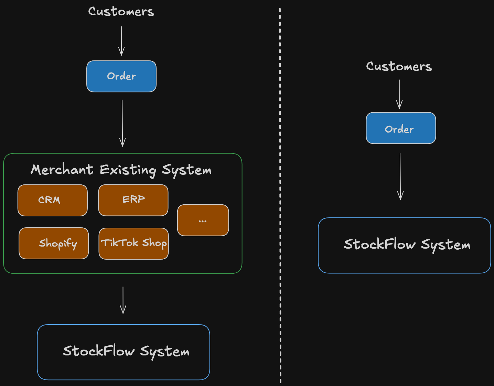
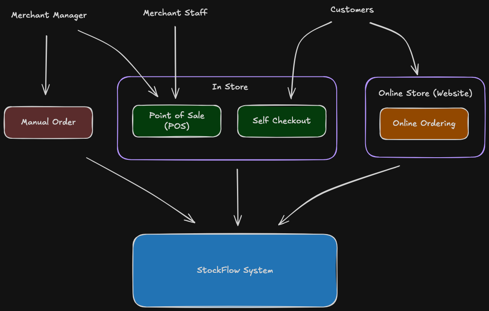
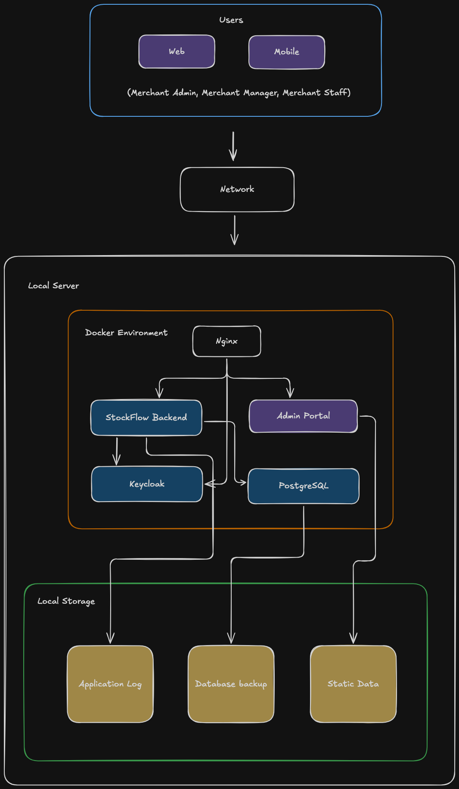
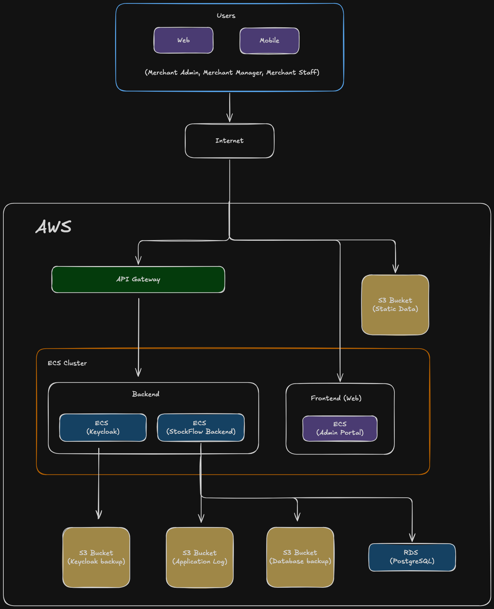
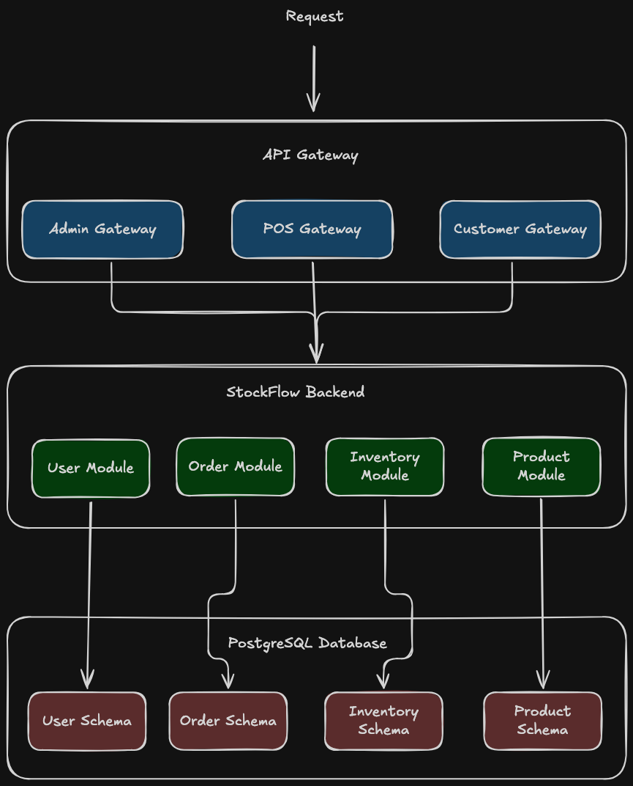

# StockFlow

## Overview

StockFlow is an order and inventory management system designed for small merchants, including family-run businesses and early-stage retailers. It provides a simple and reliable way to manage orders and stock without requiring merchants to replace the tools they already use. StockFlow can operate as a standalone system or connect with existing business systems. It supports sales from `Online Store`, `In-Store Checkouts`, and `Mobile Purchase`. By bringing information from these channels together, StockFlow gives the business one consistent and up-to-date view of its orders and inventory.

## Project Goals

- Help merchants maintain accurate and consistent inventory information across multiple sales channels and business systems
- Explore reliable and maintainable approaches to system integration, inventory updates, and data synchronisation
- Gain practical experience with unfamiliar technologies, software architecture patterns, and system integration techniques
- Apply newly learned concepts by building a realistic, working system

## How StockFlow works

Merchants can integrate StockFlow with their existing system such as ERP, CRM and e-commerce platform, or use StockFlow as a standalone inventory management system. The primary goal is to reduce the inventory inconsistencies, minimise overselling and provide a reliable view of stock availability across connected systems.

## Core Features

- Supports `POS`, `Self Checkout`, `Online Ordering` and `Manual Ordering` through channel gateways.
- Maintains a centralised inventory system to synchronise stock levels across multiple sales channels.
- Creates, tracks and manages orders from different sales channels.
- Manages products, categories, pricing and shared product information.
- Supports user management, roles, permissions and Role-Based Access Control (RBAC).

## Order Channel Overview

Each merchant has different sales channel requirements. Some businesses sell online through platforms such as TikTok Shop or eBay, while others primarily serve local customers through in-store purchases.

To accommodate these different business needs, StockFlow supports three main order channels: `In-Store Orders`, `Online Orders` and `Manual Orders`.

StockFlow allows users to create and manage orders through different channels based on their roles and permissions:

- `Merchant Manager`: Can manually create, amend and manage orders, as well as use the POS system to assist customers in-store.
- `Merchant Staff`: Can use the POS system to create and process customer orders in-store.
- `Customer`: Can independently place orders through self-checkout terminals in-store or through the online store.

## System Infrastructure Overview

StockFlow has two infrastructure configurations for local development environment and cloud environment hosted on Amazon Web Services (AWS).

The development environment uses Docker to run the application services locally, while the cloud environment is designed to use AWS-managed infrastructure for application deployment, database hosting and file storage.

### Development Setup

The development environment runs on a local machine using Docker containers. It consists of the StockFlow Backend, Keycloak, PostgreSQL, Nginx and the Admin Portal.

Nginx acts as a reverse proxy, routing incoming requests to the appropriate application services. Keycloak handles authentication and identity management, while PostgreSQL provides persistent database storage.

Application logs, database backups and static files are stored on the local SSD.

### Cloud Setup

In Cloud environment, it uses AWS Cloud service. The admin portal, database and backend service including StockFlow backend and Keycloak use ECS Cluster. It uses S3 Bucket for different file log, including Keycload backup, Application log, database backup and static data. Also it uses API gateway to route to backend APIs without exposing the backend ip address.

The cloud environment is designed to run on Amazon Web Services (AWS), using managed services for application hosting, database storage and file management.

- Amazon ECS: Runs the containerised application services, including the StockFlow Backend, Keycloak and Admin Portal.
- Amazon RDS (PostgreSQL): Provides a managed relational database for persistent application data.
- Amazon S3: Stores static files, application logs and backups, including database and Keycloak backups.
- Amazon API Gateway: Provides an entry point for backend API requests, routing traffic to the appropriate backend services.

This setup separates application services from persistent storage and provides a foundation for future scalability and infrastructure improvements.

## System Design Overview

All incoming requests pass through the API gateway before reaching the StockFlow backend. The gateway exposes separate API routes for administrative users, merchant staff using the POS system, and customers. This separation allows routing, authentication, authorization, and other policies to be tailored to each client type.

The StockFlow backend follows a modular monolith architecture. It is deployed as a single application, while its business capabilities are organised into clearly defined modules, such as User, Order, Inventory, and Product.

Each module owns its business logic and the corresponding schema within a shared PostgreSQL database. Modules communicate through well-defined interfaces and do not directly access schemas owned by other modules. These boundaries improve maintainability and reduce coupling while retaining the operational simplicity of a monolith.

If future scaling or operational requirements justify it, an individual module can be extracted into an independently deployable service with minimal impact on the rest of the system.

## Technical Decisions

- **Modular Monolith Architecture**
  - The system starts as a single backend application to simplify development, testing, and deployment during the early stages of the project.

- **Service Boundaries**
  - The backend application is separated into modules such as inventory, order, product, and authentication. This keeps module responsibilities clear and provides flexibility to extract individual modules into independent microservices in the future if specific services require independent scaling.

- **Multiple Gateways**
  - The system uses separate gateways for `POS`, `Customer`, and `Manual` gateway to isolate traffic, apply channel-specific request handling, and avoid exposing the internal backend structure publicly.

- **PostgreSQL as the Primary Database**
  - PostgreSQL supports multiple schemas within a single database, allowing tables to be logically separated by module, such as `inventory`, `product`, `order`, and `authentication`.
  - The system uses a relational database to support structured domain data and transactional consistency.

- **Cloud-Native Deployment**
  - The project is designed to deploy a containerised backend using Docker and Kubernetes to practise production-style infrastructure patterns.

## Status Definitions

The following statuses are used to indicate the current state of documentation sections and related repositories.

| Status | Meaning |
|---|---|
| Active | Currently available and being maintained |
| In Progress | Currently being written, implemented, or updated |
| Planned | Intended for a future phase |

### Documentation Structure

| Section | Description | Status |
|---|---|---|
| `README.md` | Project overview, goals, architecture summary, technical decisions, and documentation navigation | Active |
| `architecture/` | High-level architecture design, gateway design, modular monolith design, and system diagrams | Active |
| `functional-specs/` | Functional requirements, business workflows and behaviour | Active |
| `technical-specs/` | Technical design details, API design, transaction handling, and concurrency strategy | Planned |
| `database/` | Database schema design, ERD, table relationships, and PostgreSQL schema strategy | In Progress |
| `modules/` | Module responsibilities, service boundaries, and ownership of business capabilities | Planned |
| `deployment/` | Docker, Kubernetes, and cloud deployment documentation | Planned |

### Related Repositories

| Repository | Description | Status |
|---|---|---|
| `stockflow-docs` | Project documentation and system design materials | Active |
| `stockflow-backend` | Core backend application using modular monolith architecture | Planned |
| `stockflow-pos-gateway` | Gateway for Point of Sale traffic and POS-specific API handling | Planned |
| `stockflow-retail-gateway` | Gateway for retail ordering traffic and retail-specific API handling | Planned |
| `stockflow-online-gateway` | Gateway for online ordering traffic and online-store API handling | Planned |

