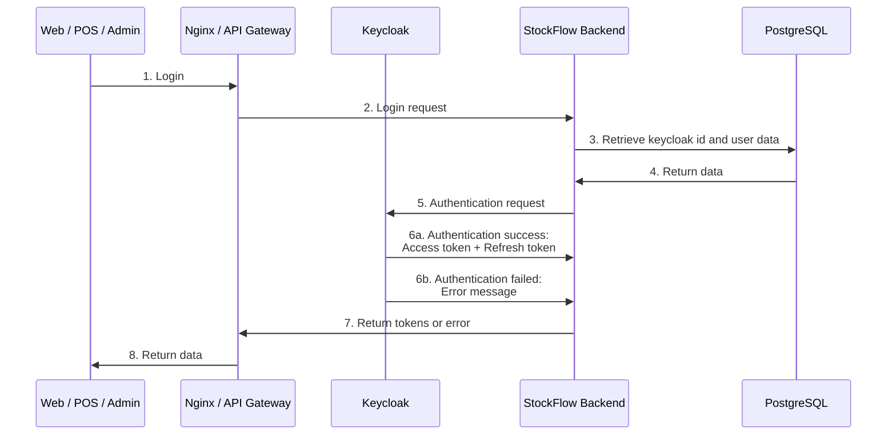

# System Architecture

## Architecture Overview

StockFlow is an order and inventory management platform designed for restaurant and retail merchants. It supports four primary order workflows: `Point of Sale (POS)`, `Online Ordering`, `Self Checkout`, and `Manual`.

StockFlow adopts a modular monolith architecture, where the backend is organised into clearly defined business modules. This architecture reduces development, testing, and deployment complexity during the initial implementation while maintaining clear module boundaries. Each module owns its business responsibilities and communicates with other modules through well-defined application interfaces rather than accessing another module's data directly.

The core business modules are:

- Authentication and Access Control
- Product Management
- Inventory Management
- Order Management

StockFlow uses a shared PostgreSQL database for data storage. PostgreSQL schemas are used to separate business modules, providing logical boundaries between modules while maintaining a single shared database.

The modular monolith architecture is designed to evolve as the platform grows. Individual modules can be extracted into independent services when scaling, deployment, or operational requirements justify separate ownership, allowing the system to evolve towards a microservices architecture without significant redesign.

## Request Flow

The request flow illustrates how client requests are processed within the StockFlow platform. Requests from different order channels enter the system through the appropriate gateway, where they are authenticated and routed to the relevant backend modules. The backend modules execute the required business logic, interact with the data layer when necessary, and return the response to the client.

### Authentication

StockFlow uses `Keycloak` as its Identity Provider (IdP) to manage user authentication and issue access and refresh tokens. The StockFlow Backend serves a resource server, while Nginx serves as the API Gateway to route incoming requests.

The authentication request follows these steps:

1. **Login Request:** The client application (Web, POS or Admin) sends a login request through the API Gateway.
2. **Request Routing:** The API Gateway forwards the authentication request to the StockFlow Backend.
3. **User Lookup:** The backend retrieves the relevant user information, including the associated Keycloak user ID, from PostgreSQL.
4. **Authentication:** The backend submits an authentication request to Keycloak to verify the user's credentials.
5. **Authentication Response:** Keycloak processes the request and returns either:
   - **Success:** An access token and refresh token.
   - **Failure:** An authentication error.
6. **Response:** The backend forwards the authentication result through the API Gateway to the client application.

Once authenticated, the client can use the access token to access protected StockFlow APIs.

