# Product ER Diagram

## Table Explanation

This section describes the purpose and relationships of each table in the Product schema.

### t_category

- Each `Category` can have multiple `Product`
- Each `Category` can have multiple `Category Translation`

### t_category_translation

- Each `Category Translation` belongs to one `Category`

### t_product

- A `Product` can be assigned to multiple `Category`
- A `Product` can be assigned to multiple `Shop`
- Each `Product` can have multiple `Product Price`
- Each `Product` can have multiple `Product Translation`

### t_product_price

- Each `Product Price` belongs to one `Product`
- Each `Product Price` belongs to one `Sales Channel`

### t_product_translation

- Each `Product Translation` belongs to one `Product`

### t_sales_channel

- Each `Sales Channel` can have multiple `Product Price`

### t_shop

- Each `Shop` has one `Shop Profile`
- Each `Shop` has one `Shop Setting`
- Each `Shop` can have multiple `Shop Translation`
- Each `Shop` belongs to one `Currency`

### t_shop_profile

- Each `Shop Profile` belongs to one `Shop`

### t_shop_setting

- Each `Shop Setting` belongs to one `Shop`

### t_shop_translation

- Each `Shop Translation` belongs to one `Shop`
- Each `Shop Translation` belongs to one `Language`

### t_currency

- Each `Currency` can have multiple `Shop`

### t_language

- Each `Language` can have multiple `Shop Translation`

```mermaid
---
title: Product Schema
---
erDiagram

    t_category {
        SERIAL id PK

        varchar(100) code "Not Null"
        varchar(20) status "Not Null"

        timestamp created_at
        timestamp updated_at
        SERIAL created_by
        SERIAL updated_by
    }

    t_category_translation {
        SERIAL id PK
        SERIAL category_id FK "Not Null"

        varchar(10) language_code "Not Null"
        varchar(255) name "Not Null"
        varchar(255) description

        timestamp created_at
        timestamp updated_at
        SERIAL created_by
        SERIAL updated_by
    }
    t_category ||..o{ t_category_translation : category_id

    t_product {
        SERIAL id PK

        varchar(100) code "Not Null"        
        varchar(20) status "Not Null"

        decimal default_price

        timestamp created_at
        timestamp updated_at
        SERIAL created_by
        SERIAL updated_by
    }

    t_product_translation {
        SERIAL id PK
        SERIAL product_id FK "Not Null"

        varchar(10) language_code "Not Null"
        varchar(255) name "Not Null"
        varchar(255) description

        timestamp created_at
        timestamp updated_at
        SERIAL created_by
        SERIAL updated_by
    }
    t_product ||..o{ t_product_translation : product_id

    t_product_category_mapping {
        int id PK
        SERIAL category_id FK "Not Null"
        SERIAL product_id FK "Not Null"
    }
    t_category ||..o{ t_product_category_mapping : category_id
    t_product ||..o{ t_product_category_mapping : product_id
    
    t_shop_product_mapping {
        int id PK

        SERIAL shop_id FK "Not Null"
        SERIAL product_id FK "Not Null"
        
        boolean available "Not Null"

        timestamp created_at
        timestamp updated_at
        SERIAL created_by
        SERIAL updated_by
    }
    t_product ||--o{ t_shop_product_mapping : product_id
    t_shop ||--o{ t_shop_product_mapping : shop_id

    t_product_price {
        SERIAL id PK
        SERIAL shop_id "Not Null"
        
        SERIAL product_id FK "Not Null"
        SERIAL sales_channel_id FK "Not Null"

        decimal amount "Not Null"

        timestamp created_at
        timestamp updated_at
        SERIAL created_by
        SERIAL updated_by
    }
    t_product ||--o{ t_product_price : product_id

    t_sales_channel {
        SERIAL id PK

        varchar(50) code UK "Not Null"
        varchar(100) name "Not Null"
        varchar(20) status "Not Null"

        timestamp created_at
        timestamp updated_at
        SERIAL created_by
        SERIAL updated_by
    }
    t_sales_channel ||--o{ t_product_price : sales_channel_id

    t_currency {
        varchar(3) code PK

        varchar(100) name "Not Null"
        varchar(10) symbol
        smallint decimal_places "Not Null"
        boolean active "Not Null"

        timestamp created_at
        timestamp updated_at
        SERIAL created_by
        SERIAL updated_by
    }
    t_currency ||..o{ t_shop : currency_code

    t_language {
        varchar(10) code PK

        varchar(100) name "Not Null"
        boolean active "Not Null"

        timestamp created_at
        timestamp updated_at
        SERIAL created_by
        SERIAL updated_by
    }

    t_shop {
        SERIAL id PK

        varchar(100) code "Not Null"
        varchar(20) status "Not Null"

        varchar(3) currency_code FK "Not Null"

        timestamp created_at
        timestamp updated_at
        SERIAL created_by
        SERIAL updated_by
    }

    t_shop_translation {
        SERIAL id PK
        SERIAL shop_id FK "Not Null"

        varchar(10) language_code "Not Null"

        varchar(255) name "Not Null"

        timestamp created_at
        timestamp updated_at
        SERIAL created_by
        SERIAL updated_by
    }
    t_shop ||--o{ t_shop_translation : shop_id
    t_language ||--o{ t_shop_translation : language_code

    t_shop_profile {
        int id PK
        SERIAL shop_id FK, UK "Not Null"

        varchar(10) phone_country_code
        varchar(30) phone_number

        varchar(100) country
        varchar(100) city
        varchar(20) postcode

        varchar(255) address_line_1
        varchar(255) address_line_2

        timestamp created_at
        timestamp updated_at
        SERIAL created_by
        SERIAL updated_by
    }
    t_shop ||--|| t_shop_profile : shop_id

    t_shop_setting {
        int id PK
        SERIAL shop_id FK, UK "Not Null"

        varchar(10) default_language_code FK "Not Null"
        varchar(20) order_prefix "Not Null"

        timestamp created_at
        timestamp updated_at
        SERIAL created_by
        SERIAL updated_by
    }
    t_shop ||--|| t_shop_setting : shop_id
    t_language ||..o{ t_shop_setting : language_code




```

